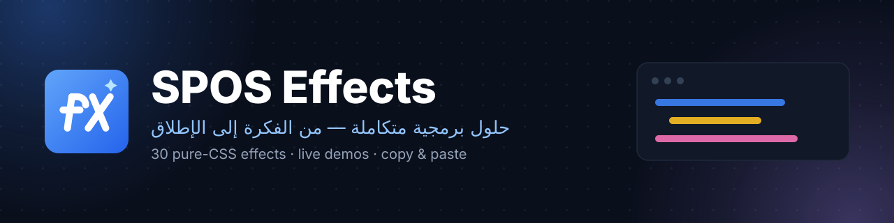
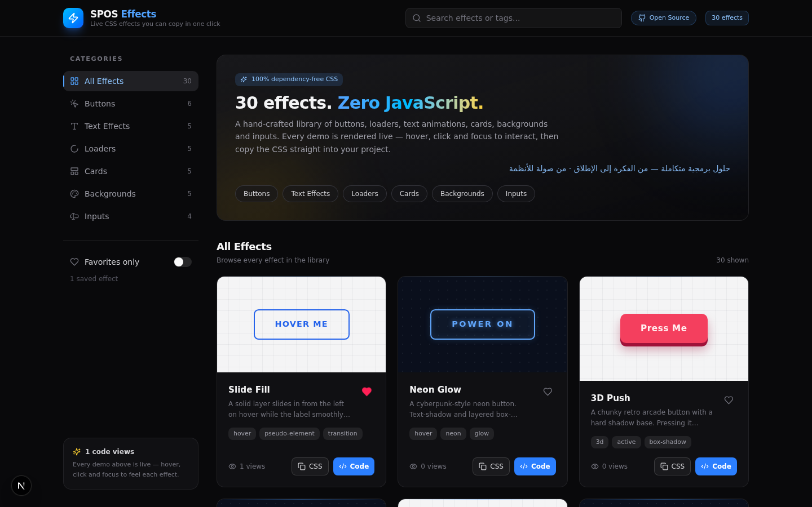
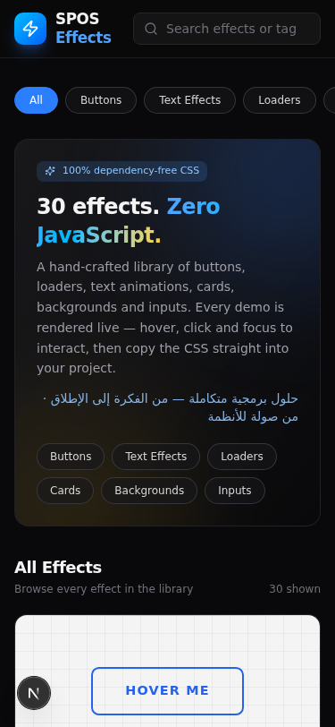
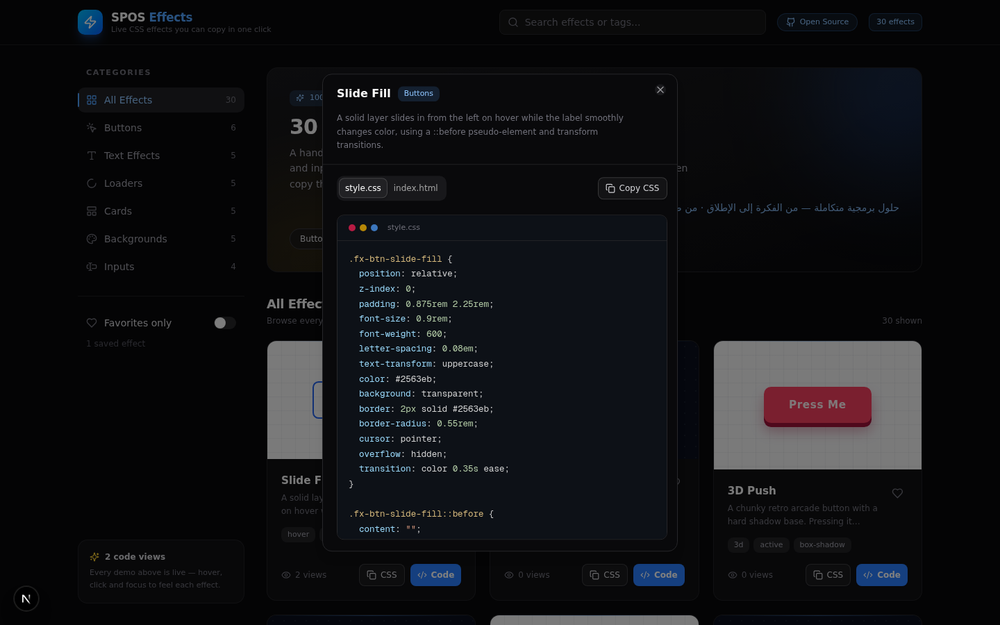

<p align="center">
  
</p>

<p align="center">
  <em>Complete software solutions — from idea to launch</em>
  <br>
  <em>حلول برمجية متكاملة — من الفكرة إلى الإطلاق</em>
</p>

<p align="center">
  <a href="LICENSE"></a>
  <a href="#the-collection"></a>
  
  <a href="CONTRIBUTING.md"></a>
  
  <a href="https://spos.ly"></a>
  <a href="https://spos-systems.github.io/SPOS-Effects/"></a>
</p>

<p align="center">
  <strong>Try it live: <a href="https://spos-systems.github.io/SPOS-Effects/">spos-systems.github.io/SPOS-Effects</a> — no installation needed.</strong>
</p>

SPOS Effects is an open-source CSS effects library by [SPOS Systems](https://spos.ly). It ships 30 hand-crafted, 100% dependency-free, pure-CSS effects across six categories — buttons, text effects, loaders, cards, backgrounds, and inputs — each with a live interactive demo and copy-ready CSS/HTML code. The effects themselves require zero JavaScript: every class is prefixed with `fx-`, every snippet is fully self-contained, and everything works with any framework (or no framework at all).

The companion demo site — built with Next.js 16, TypeScript, Tailwind CSS 4, shadcn/ui, and Prisma/SQLite — lets you preview every effect on dark and light stages, search and filter the collection, save your favorites, and copy code with a single click.

## Highlights

- 30 hand-crafted effects across 6 categories
- 100% pure CSS — zero JavaScript required for the effects
- Zero dependencies — every snippet is fully self-contained
- `fx-` class prefix on every effect, so nothing collides with your existing styles
- Live demos on dark and light stages
- One-click copy for both CSS and HTML
- Syntax-highlighted code dialog for every effect
- Search, category filtering, favorites, and view counters
- Fully responsive, dark-themed demo with accessibility built in (ARIA labels, semantic HTML, keyboard navigation)
- Works with any framework — React, Vue, Svelte, Angular, or plain HTML

## The Collection

| Category | Effects |
| --- | --- |
| **Buttons** (6) | Slide Fill, Neon Glow, 3D Push, Border Runner, Arrow Swap, Ripple Press |
| **Text Effects** (5) | Gradient Flow, Typewriter, Highlight Sweep, Glitch, Wave Letters |
| **Loaders** (5) | Dual Ring, Bouncing Dots, Pulse Ring, Stripe Progress Bar, Orbit |
| **Cards** (5) | Hover Lift, 3D Flip, Spotlight, Image Zoom Reveal, Animated Gradient Border |
| **Backgrounds** (5) | Shifting Gradient, Futuristic Grid, Drifting Dot Matrix, Moving Diagonal Stripes, Aurora |
| **Inputs** (4) | Underline Grow, Floating Label, Glow Focus, Expanding Search |

## Screenshots

<table>
  <tr>
    <td width="50%"></td>
    <td width="50%"></td>
  </tr>
  <tr>
    <td colspan="2" align="center"></td>
  </tr>
</table>

## Getting Started

### Option 1 — Use the whole library

The fastest way to use SPOS Effects: one file, all 30 effects.

Either reference it straight from the CDN (no download needed):

```html
<link rel="stylesheet" href="https://cdn.jsdelivr.net/gh/spos-systems/SPOS-Effects@v1.0.1/spos-effects.css" />
```

…or copy `spos-effects.css` from the repository root into your project and include it:

```html
<link rel="stylesheet" href="spos-effects.css" />
```

Then add an effect class to any element:

```html
<button class="fx-btn-neon-glow">Get Started</button>
```

Each effect's exact HTML markup is shown in its code dialog on the demo — open the effect, click the code button, and copy both the CSS and the HTML straight into your project. Every effect also has a shareable deep link, e.g. `https://spos-systems.github.io/SPOS-Effects/?effect=btn-neon-glow`, which opens that effect's code dialog directly.

### AI-friendly by design

The demo site ships machine-readable endpoints so search engines and AI agents can index the library accurately:

- [`llms.txt`](https://spos-systems.github.io/SPOS-Effects/llms.txt) — curated overview of the library for LLMs
- [`llms-full.txt`](https://spos-systems.github.io/SPOS-Effects/llms-full.txt) — full reference including every HTML snippet and the complete CSS
- [`effects.json`](https://spos-systems.github.io/SPOS-Effects/effects.json) — machine-readable catalog (ids, categories, tags, demo links)
- Structured data on every page: `Organization`, `WebSite`, `SoftwareApplication`, and `FAQPage` (JSON-LD)

### Option 2 — Run the demo site locally

Requirements: [Bun](https://bun.sh) v1+ (recommended) or Node.js 18+.
```bash
bun install          # install dependencies
cp .env.example .env # create the local environment file
bun run db:push      # create the local SQLite database
bun run dev          # start the dev server on port 3000
```

Open http://localhost:3000. Favorites and view counters are persisted in SQLite through Prisma.

### Option 3 — GitHub Pages (automatic deployment)

The repository ships with a ready-made workflow ([`.github/workflows/deploy.yml`](.github/workflows/deploy.yml)) that builds the demo as a pure static export and publishes it to GitHub Pages on every push to `main`. On GitHub, enable it once under **Settings → Pages → Build and deployment → Source: GitHub Actions**, and your copy of the demo goes live at `https://<your-user>.github.io/SPOS-Effects/`.

In the static build the API routes are stripped out and the demo automatically switches to `localStorage` persistence for favorites and view counters (see [`src/lib/client-store.ts`](src/lib/client-store.ts)) — every feature keeps working with zero backend.

### Available scripts

| Command | Description |
| --- | --- |
| `bun install` | Install dependencies |
| `bun run dev` | Start the Next.js dev server at http://localhost:3000 |
| `bun run lint` | Run ESLint |
| `bun run build:css` | Regenerate the compiled `spos-effects.css` stylesheet |
| `bun run build:meta` | Regenerate `effects.json`, `llms.txt`, `llms-full.txt` & `humans.txt` |
| `bun run db:push` | Apply the Prisma schema to the SQLite database |

## Project Structure

```
SPOS-Effects/
├── src/
│   ├── app/                    # Next.js pages & API routes
│   ├── components/
│   │   └── library/            # Demo UI components (cards, stages, code dialog, search)
│   └── lib/
│       └── effects/            # The effects library data — the heart of the project
├── prisma/                     # Prisma schema (SQLite: favorites & view stats)
├── .github/                    # CI workflows & issue/PR templates
└── spos-effects.css            # Compiled all-in-one stylesheet (all 30 effects)
```

## Contributing

Contributions are welcome — new effects, bug fixes, and documentation improvements alike. Read [CONTRIBUTING.md](CONTRIBUTING.md) to get started, and check out the "Adding a new effect" guide before submitting your first effect.

## Show Your Support

If SPOS Effects saved you time, please:

- Star the repository — it helps other developers discover the project
- Share it with your team and community
- Get in touch — we build complete software solutions, from idea to launch:
  - Website: https://spos.ly
  - WhatsApp: https://wa.me/218935535606
  - Phone: +218 93 553 5606

## License

SPOS Effects is released under the [MIT License](LICENSE).

---

# النسخة العربية

## نظرة عامة

SPOS Effects مكتبة مفتوحة المصدر من صولة للأنظمة (SPOS Systems) تضم 30 تأثيراً مصنوعاً بعناية، مكتوبة بلغة CSS الخالصة بنسبة 100% وبدون أي اعتماديات خارجية، موزعة على ست فئات: الأزرار، وتأثيرات النصوص، ومؤشرات التحميل، والبطاقات، والخلفيات، وحقول الإدخال. لكل تأثير عرض تفاعلي مباشر مع كود CSS وHTML جاهز للنسخ بنقرة واحدة. لا يحتاج أي تأثير إلى JavaScript — جميع الأصناف تبدأ بالبادئة `fx-`، وكل مقتطف مستقل بذاته ويعمل مع أي إطار عمل أو بدون إطار على الإطلاق.

موقع العرض التفاعلي المصاحب — المبني بتقنيات Next.js 16 وTypeScript وTailwind CSS 4 وshadcn/ui مع Prisma وSQLite — يتيح لك معاينة كل تأثير على مسارح داكنة وفاتحة، والبحث والتصفية داخل المجموعة، وحفظ المفضلة، ونسخ الكود بنقرة واحدة.

## المزايا

- 30 تأثيراً موزعة على 6 فئات
- CSS خالص بنسبة 100% — بدون أي JavaScript لتشغيل التأثيرات
- بدون أي اعتماديات — كل مقتطف مستقل بذاته
- بادئة `fx-` لجميع الأصناف لتفادي أي تعارض مع أنماط مشروعك
- عروض تفاعلية مباشرة على مسارح داكنة وفاتحة
- نسخ كود CSS وHTML بنقرة واحدة
- نافذة كود مع تلوين الصياغة لكل تأثير
- بحث وتصفية حسب الفئة، مع مفضلة وعدّادات مشاهدات
- موقع عرض متجاوب بالكامل وبثيم داكن مع اهتمام بإمكانية الوصول (ARIA وHTML الدلالي والتنقل بلوحة المفاتيح)
- يعمل مع أي إطار عمل — React أو Vue أو Svelte أو Angular أو HTML خالص

## مجموعة التأثيرات

| الفئة | التأثيرات |
| --- | --- |
| **أزرار** (6) | Slide Fill, Neon Glow, 3D Push, Border Runner, Arrow Swap, Ripple Press |
| **تأثيرات النصوص** (5) | Gradient Flow, Typewriter, Highlight Sweep, Glitch, Wave Letters |
| **مؤشرات التحميل** (5) | Dual Ring, Bouncing Dots, Pulse Ring, Stripe Progress Bar, Orbit |
| **البطاقات** (5) | Hover Lift, 3D Flip, Spotlight, Image Zoom Reveal, Animated Gradient Border |
| **الخلفيات** (5) | Shifting Gradient, Futuristic Grid, Drifting Dot Matrix, Moving Diagonal Stripes, Aurora |
| **حقول الإدخال** (4) | Underline Grow, Floating Label, Glow Focus, Expanding Search |

## البدء السريع

جرّب المكتبة مباشرة بدون أي تثبيت: **[spos-systems.github.io/SPOS-Effects](https://spos-systems.github.io/SPOS-Effects/)**

### أولاً: استخدام المكتبة كاملة

أسرع طريقة للاستفادة من المكتبة: ملف واحد يضم التأثيرات الثلاثين جميعها — إما مباشرة من الـ CDN:

```html
<link rel="stylesheet" href="https://cdn.jsdelivr.net/gh/spos-systems/SPOS-Effects@v1.0.1/spos-effects.css" />
```

أو بنسخ ملف spos-effects.css من جذر المستودع إلى مشروعك وربطه في صفحتك:

```html
<link rel="stylesheet" href="spos-effects.css" />
```

ثم أضف صنف التأثير إلى أي عنصر:

```html
<button class="fx-btn-neon-glow">ابدأ الآن</button>
```

يعرض موقع العرض كود HTML الدقيق لكل تأثير داخل نافذة الكود الخاصة به — افتح التأثير، واضغط زر الكود، وانسخ CSS وHTML مباشرة إلى مشروعك. لكل تأثير أيضاً رابط مشاركة مباشر مثل `?effect=btn-neon-glow` يفتح نافذة الكود مباشرة.

كما يوفر الموقع نقاط نهاية صديقة للذكاء الاصطناعي: `llms.txt` و`llms-full.txt` و`effects.json` لفهرسة المكتبة بدقة من محركات البحث ووكلاء الذكاء الاصطناعي.

### ثانياً: تشغيل موقع العرض محلياً

المتطلبات: Bun بإصدار 1 أو أحدث (موصى به) أو Node.js 18 أو أحدث.

```bash
bun install          # تثبيت الاعتماديات
cp .env.example .env # إنشاء ملف البيئة المحلي
bun run db:push      # إنشاء قاعدة بيانات SQLite المحلية
bun run dev          # تشغيل خادم التطوير على المنفذ 3000
```

ثم افتح http://localhost:3000. تُحفظ المفضلة وعدّادات المشاهدات في SQLite عبر Prisma.

### الأوامر المتاحة

| الأمر | الوصف |
| --- | --- |
| `bun install` | تثبيت الاعتماديات |
| `bun run dev` | تشغيل خادم التطوير على http://localhost:3000 |
| `bun run lint` | تشغيل ESLint |
| `bun run build:css` | إعادة توليد ملف spos-effects.css |
| `bun run db:push` | تطبيق مخطط Prisma على قاعدة SQLite |

## المساهمة

نسعد بمساهماتكم — تأثيرات جديدة، وإصلاح للأخطاء، وتحسينات على التوثيق. اقرأ ملف CONTRIBUTING.md للبدء، وتعرّف على دليل إضافة تأثير جديد قبل إرسال أول تأثير لك.

## أظهر دعمك

إذا وفّر لك SPOS Effects الوقت والجهد:
- امنح المستودع نجمة ليصل إلى المزيد من المطورين
- شاركه مع فريقك ومجتمعك
- تواصل معنا — نقدم حلولاً برمجية متكاملة من الفكرة إلى الإطلاق:
  - الموقع: https://spos.ly
  - واتساب: https://wa.me/218935535606
  - الهاتف: 0935535606 (+218 93 553 5606 دولياً)

## الرخصة

يُنشر SPOS Effects بموجب رخصة MIT — راجع ملف LICENSE للتفاصيل.

---

<p align="center">
  <strong>SPOS Effects — Crafted with care by صولة للأنظمة (SPOS Systems)</strong>
</p>

<p align="center">
  <a href="https://spos.ly">Website</a> · <a href="https://wa.me/218935535606">WhatsApp</a> · +218 93 553 5606
</p>
